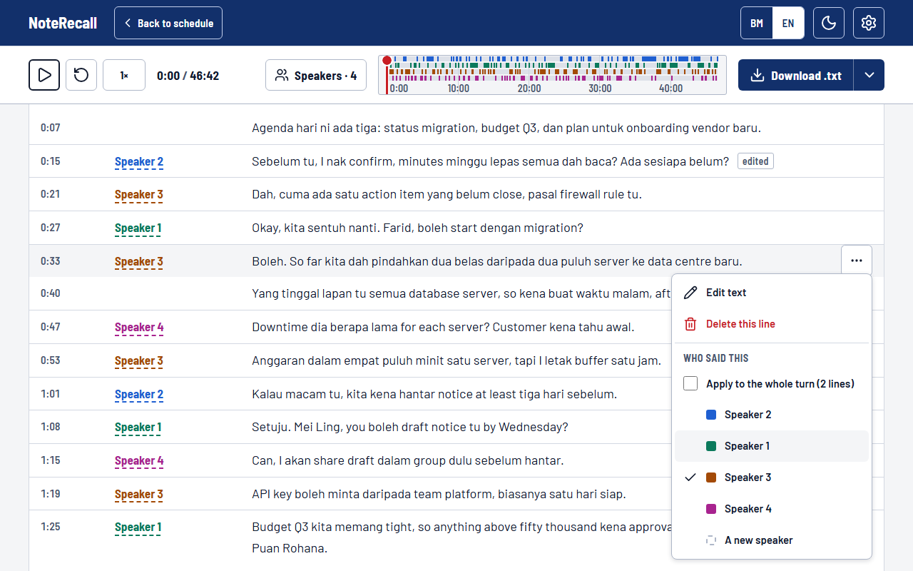
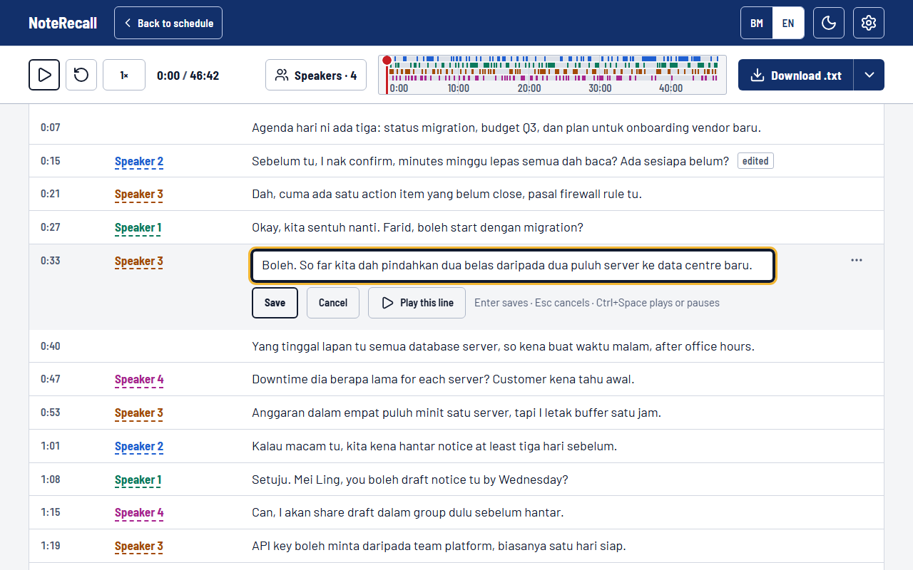
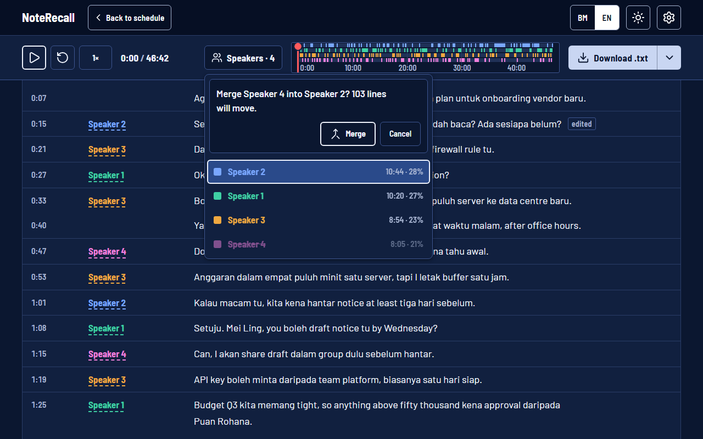
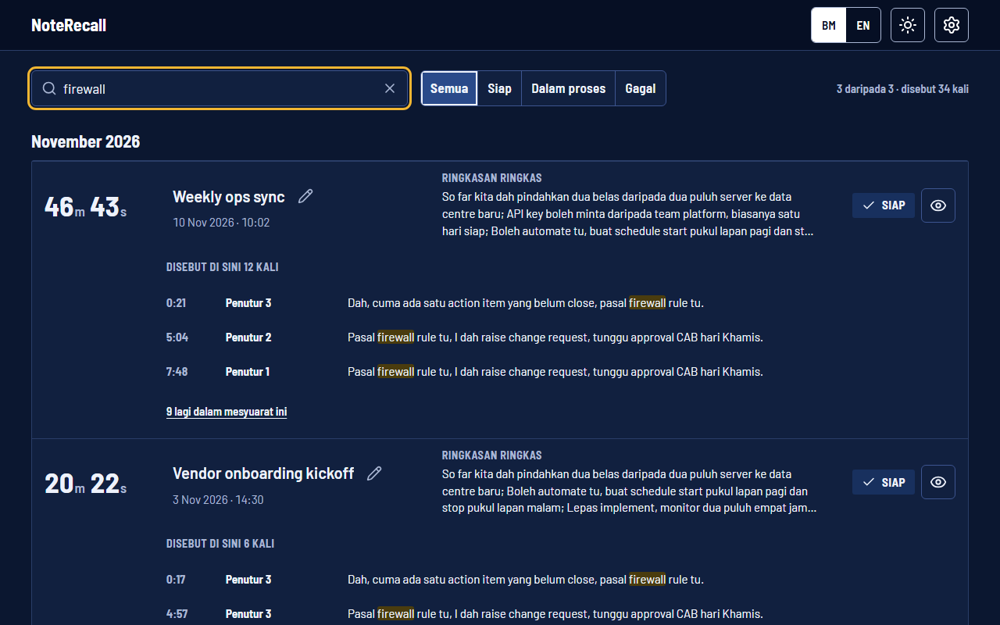
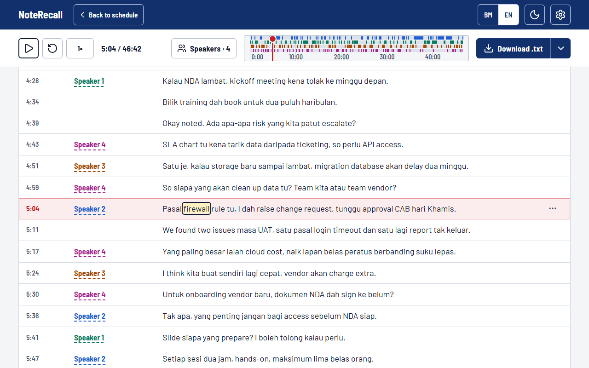
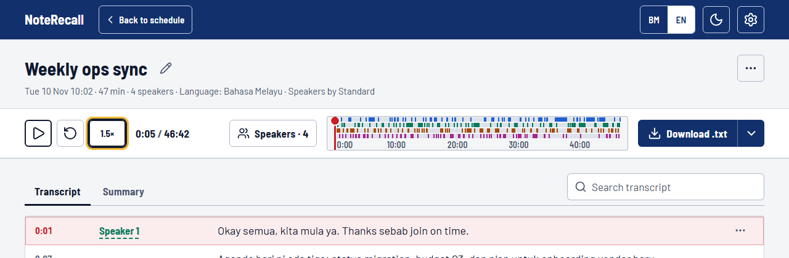
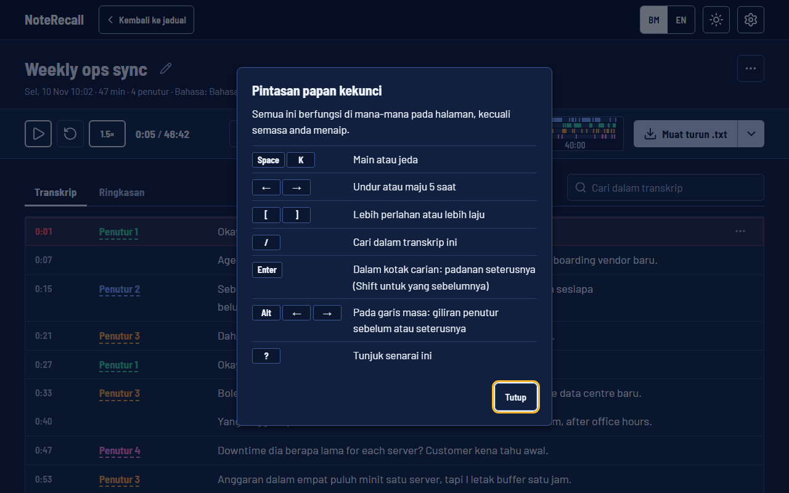
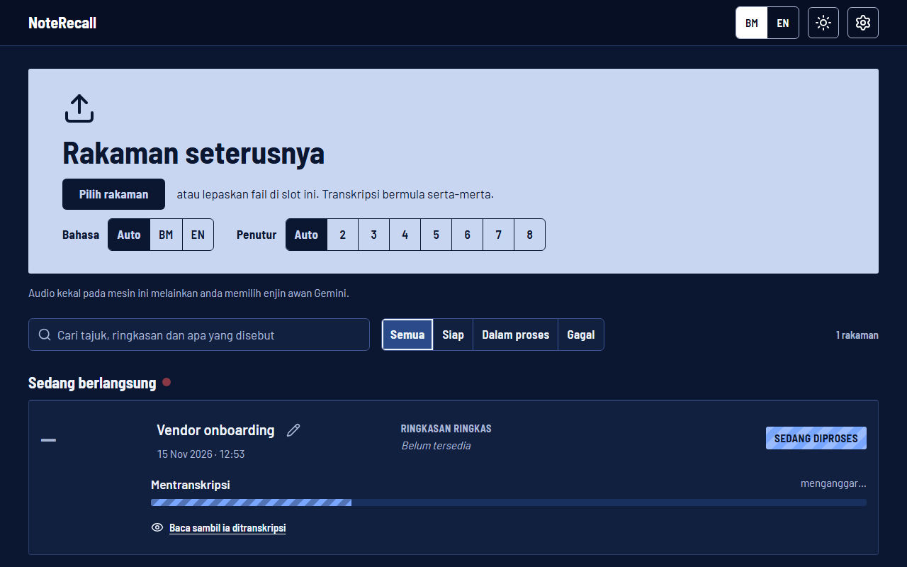
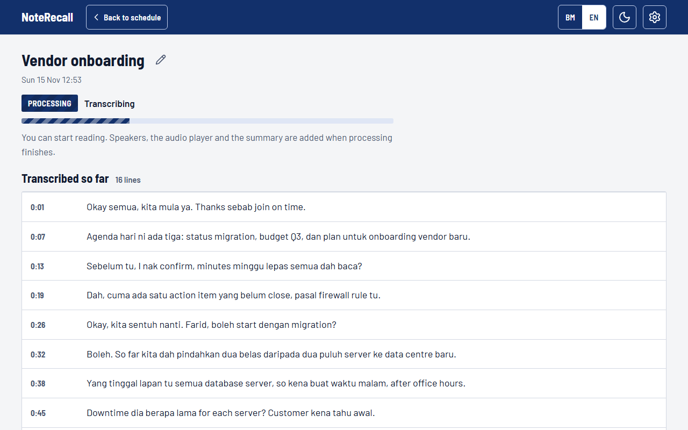

# NoteRecall 10x report

Branch `10x`, local only. Nothing was pushed, merged or tagged, and `VERSION`
is unchanged. Your `data/`, `config.json` and `models/` were not modified.

## What is different

Four improvements, one for each step of your loop, and three bug fixes.

| Step of your loop | Before | Now |
|---|---|---|
| Wait | A progress bar until everything had finished | The transcript appears line by line while it is processed, and the browser tab shows the percentage |
| Review against the audio | 1× only; keys worked only with the ribbon focused | Speed 0.75× to 2×, back 5 s, and Space / arrows / `[` `]` / `/` / `?` anywhere on the page |
| Fix what is wrong | Rename speakers, or redo the whole meeting | Edit a line, move a line or a turn to another speaker, delete a line, merge two speakers; all of it can be undone |
| Find a moment later | Only if you remembered which meeting | The Home search looks inside every transcript and opens the meeting at that second |

Bugs fixed: a few words shown as lasting minutes (1% of your lines, 126
minutes of talk time that never happened), a stray scrollbar on the
Transcript / Summary tabs, and the Back button overlapping the language switch
on a phone.

## How to try it

Your working folder is already on the `10x` branch. No copy of NoteRecall was
running on port 8756 when I finished.

```
cd D:\Projects\NoteRecall
git status
start.bat
```

`git status` should say `On branch 10x`. `start.bat` opens the app with your
real meetings. To run it beside another copy instead, pick a port:

```
$env:PORT = "8760"; .venv\Scripts\python.exe server.py
```

Then:

1. **Search.** On the first page type a word you remember from any meeting.
   Rows where it was said show the moments; click one.
2. **Listen.** In the meeting press `Space`, then `]` twice, then `←`. Press
   `?` for the list of keys.
3. **Correct.** Point at a line, open **⋯** at its right edge, choose **Edit
   text**, change a word, press Enter. Open **⋯** again and choose **Restore
   the original text**. In **Speakers**, press the merge button on a speaker.
4. **Undo everything.** **⋯** at the top of the meeting → **Discard my
   corrections**. The first correction to a meeting writes
   `transcript.original.json` beside `transcript.json`; discarding restores it
   and removes the file. That is the only way this branch changes an existing
   meeting, and only when you correct something.
5. **Read while it works.** Drop a recording, then click **Read it as it is
   transcribed** on its row.

To go back to what you had: `git checkout main`. Meetings you corrected on
`10x` still open on `main` (it ignores the extra file and the extra field).

Tests:

```
.venv\Scripts\python.exe -m pytest
```

172 tests (142 without a browser, 30 in a browser). See "What was not verified"
for the two that are flaky.

## The changes

All screenshots use invented meetings, not yours.

### 1. Correct the record



Every line has a **⋯** menu: edit the text, delete the line, or say who really
said it (one line or the whole turn, an existing speaker or a new one).



The editor opens in the line itself. Enter saves, Esc cancels, Ctrl+Space
plays or pauses so you can listen while typing, and **Play this line** jumps
the audio to the start of the line. A corrected line is marked "edited" and
its menu offers the original back.



In **Speakers**, the merge button joins two speakers that are one person. This
is the quick repair for the over-split meetings (10 of your 22 have 20 to 146
"speakers"), though for those re-detecting with a fixed number is still the
better first step.

What happens underneath:

- The first correction saves the pipeline's transcript and speaker names as
  `data/<id>/transcript.original.json`. **Discard my corrections** restores it.
- The built-in summary is rewritten at once (also when you rename a speaker,
  which it did not do before). An Ollama summary is kept and marked "out of
  date" with a Regenerate link, because rewriting it takes a minute.
- Downloads use the corrected transcript.
- Re-transcribing a corrected meeting now asks first, because it replaces
  your corrections. Re-detecting speakers keeps your text and says that
  speaker changes will be replaced.
- Each request carries the line's start time, so a page left open during a
  re-transcribe cannot change the wrong line.
- When you rename a speaker, names you have used in other meetings are
  suggested.

### 2. Search everything said



The search box on Home searches titles, summaries and every transcript. A row
shows up to three moments and a count; the count on the right totals them.



A moment opens the meeting at that second, with the search already filled in
and that match current, so Enter walks to the next one. The address
(`#/m/<id>?t=304.45&q=firewall`) can be bookmarked.

There is no index and no new dependency. `search.py` reads the transcript
files and keeps the text in memory; a file is read again only when it changes.
On a library shaped like yours (22 meetings, 27,000 lines, invented text) the
first search took about 0.1 s and later ones a few milliseconds.

### 3. Listen faster



Beside Play: back 5 seconds, and a speed button (0.75×, 1×, 1.25×, 1.5×,
1.75×, 2×; remembered between meetings; the browser keeps the pitch natural).



The keys work wherever focus is, except while you are typing or when a menu,
the tabs, the ribbon or a dialog is using that key. Space on a focused button
still presses that button.

### 4. Read while it works



A processing row has a link to read along, and the browser tab reads
`26% · Vendor onboarding · NoteRecall`. If a job ends while the tab is in the
background the title starts with ✓ (or ✗ if it failed) until you look at it.



The waiting page shows the lines Whisper has produced, without speakers
(those need the whole recording). The page follows the newest line only if you
have scrolled to the end. When processing finishes, the normal meeting page
replaces it.

On a real 12.6-minute recording of yours (copied to a scratch folder, run in a
separate data directory, local engine) the first lines were on screen after
31 s; the whole job took 293 s. All 357 lines shown live matched the final
transcript.

The lines live in memory only. Nothing partial is written, so stopping the
server mid-job leaves no half transcript; the job starts again as before.

### 5. Impossible line lengths

Whisper sometimes ends a short line minutes late, across a silence. In your
22 meetings: 277 of 27,311 lines, 126 minutes in total, the longest 984 s.
Such a line painted a long block on the ribbon, added minutes to that
speaker's talk time and share, and kept a subtitle on screen for minutes in
the `.srt` download. In a new transcript it could also be given to whoever
spoke most during the silence.

`timing.py` has one rule: a line may last 10 seconds plus half a second per
character (speech is 12 to 15 characters per second; this allows 2). New
transcripts are written with the cut-back end. Your existing files are not
rewritten: the ribbon, the talk-time ranking, the built-in summary and the
`.srt` download apply the rule when they read a line. Built-in summaries
already on disk keep their old percentages until you regenerate them or
correct something in that meeting.

## Decisions I made for you

- **Base.** `10x` sits on the tip of `feat/nemotron-diarization` (commit
  `6f1fa53`), which `origin/main` already contains through PR #13. Your local
  `main` is four commits behind `origin/main`; I did not touch it.
- **No new Python dependencies, and nothing new from a CDN.** Three Lucide
  icons (merge, keyboard, undo-2) were added to `static/icons` at the same
  version as the rest.
- **Corrections change `transcript.json` and keep the original beside it**,
  rather than storing a list of edits. Every other part of the app (downloads,
  search, summary, the ribbon) reads `transcript.json` and needed no change,
  and old meetings need no migration.
- **Discarding corrections also puts speaker names back** to what they were
  before the first correction, because a merge moves names. The dialog says so.
- **Deleting a line takes two presses on the same menu item**, not a dialog.
  It is undoable (Discard), and a dialog per line would make cleaning up
  hallucinated lines slow.
- **Save in the line editor is an outlined button, not a blue plate**, to keep
  DESIGN.md's rule of one plate per screen (Download owns it).
- **Space now plays or pauses instead of scrolling the page** on a meeting.
  Page Down still scrolls.
- **Search matches the words as typed, ignoring case.** No stemming and no
  fuzzy matching: with mixed Malay and English a wrong "smart" match costs
  more than a missed one, and it is the same rule as the search inside a
  meeting.
- **Live lines are local-engine only.** Gemini is unchanged and still opt-in.
- **The line-length rule cuts the end, never the start**, and is generous, so
  an ordinary slow line is not touched. It is an estimate, and summary.md says
  so (§9, item 9).
- **GitHub issues were skipped**, as you said. `AGENTS.md` still points at a
  `CONTEXT.md` that does not exist; I left that alone.
- DESIGN.md gained four short component notes for the new UI.

## What was verified, and how

- **Tests.** 172, up from 121 at the start. The final full run, with the
  machine otherwise idle, passed all 172.
- **In a browser.** Every feature was used through Playwright against a
  scratch server with invented meetings, in light and dark, English and Malay,
  at 1280 px and at 390 px, and I looked at the screenshots. That is how the
  phone masthead overlap was found.
- **Real audio, once.** Described under "Read while it works". It ran on the
  GPU (`cuda (large-v3)`); speaker detection used the standard engine.
- **Live lines do not slow transcription.** The same 12.6-minute recording,
  one process, nothing else running, model already warm: 81.2 s without live
  lines, 83.1 s with, 80.1 s without again. The first job after a start is
  much slower either way (170 s in that process, before the three runs
  above), which is why the end-to-end run took 293 s.
- **Real data, as numbers only.** Counts, lengths and field names from your 22
  meetings; no text was read into tests, docs, commits or this report.

## What was not verified, or is shaky

- **Ollama.** Not running here. The "summary is out of date" path after a
  correction is covered by tests with a fake engine, not end to end.
- **Gemini.** Never called. The live-lines change does not touch
  `engines.py`; the Gemini path simply shows no lines.
- **Nemotron speaker detection** was not run on this branch. The pipeline
  change is inside `transcribe()` only and imports nothing new (`timing.py` is
  pure Python), so the sherpa preload order and the no-torch rule are
  untouched, but I did not prove that with a Nemotron run.
- **Two flaky tests, not mine.** `tests/test_updates_e2e.py`:
  `test_no_indicator_when_up_to_date_and_check_button_says_so` and
  `test_offline_is_a_friendly_message_not_an_error_page` sometimes fail when the machine is busy (several times during this work)
  and pass when it is idle. They failed the same
  way before my first change. The cause is in the test: the message is on the
  page twice (visibly, and in a screen-reader announcement) and the lookup
  sometimes sees both. I did not change them.
- **Playback on your real recordings** was not listened to by a person. Speed
  and seeking were checked through the audio element's state on a generated
  file.
- **Very long meetings in the waiting page.** The live list was checked with
  357 real lines, not with the 3,000 of a 2-hour meeting. The finished
  transcript page already renders that many, so I expect it to be fine.
- **Safari and Firefox** were not tried; tests run in Chromium.

## What I would do next

1. **Voice enrolment.** Name someone once, recognise them next time. It is
   now worth more, because names can be corrected and are suggested across
   meetings. It needs you: only you can tell whether a match is right.
2. **Make the two update tests reliable** (look the message up inside the
   visible alert only).
3. **Split a line in two** when Whisper joined two speakers in one line. The
   menu has room for it; it needs word timestamps or a manual split point.
4. **Regenerate old built-in summaries once**, so their talk-time numbers use
   the line-length rule. I did not, because it rewrites files in `data/`.
5. **A "new since you last looked" mark on Home** for meetings that finished
   while you were away.

## Scope, as chosen before building

This section was written before any code, as you asked, and is unchanged
except for this sentence.

Your loop is: upload, wait, review against the audio, fix speaker names, find a
moment later, take a summary or export. I read the docs and the code, used the
app in a browser with invented demo meetings, and looked at your 22 real
meetings as numbers only (lengths, counts, field names; no text was read into
this report or anywhere else).

Four things stood out.

1. **You cannot correct anything.** If Whisper mishears a word, or one line
   goes to the wrong speaker, the only tools are "re-transcribe" and "re-detect
   speakers", which redo the whole meeting. Principle 1 is "what was said,
   exactly", and review is where you find the errors, so review has to be able
   to fix them.
2. **A moment can only be found if you remember which meeting it was in.**
   Search on Home covers titles and the quick summary; search inside a meeting
   covers that one transcript. Nothing answers "where did we talk about the
   firewall rule?".
3. **Listening is slower than it needs to be.** There is no playback speed, no
   "go back five seconds", and the keyboard only works while the ribbon track
   has focus. Reviewing a 2-hour meeting at 1× with the mouse is most of the
   time the app costs you.
4. **The wait is dead time.** A long meeting takes 20 to 40 minutes here (your
   longest took 2,389 s). During that time the app shows a bar. The text
   Whisper has already produced is not shown until everything, including
   speakers and summary, has finished.

So the scope is four improvements, one per step of the loop, plus the real bugs
I found on the way:

| # | Step of the loop | Improvement |
|---|---|---|
| 1 | Review, fix speakers | **Correct the record**: edit a line's text, move a line or a whole turn to another speaker, merge two speakers, and undo all of it. The original is kept. |
| 2 | Find a moment later | **Search everything said**: the Home search also searches every transcript and links straight to the moment. |
| 3 | Review against the audio | **Listen faster**: playback speed, back 5 s, and keys that work anywhere on the page. |
| 4 | Wait | **Read while it works**: the transcript appears line by line during processing, and the browser tab shows progress. |

Bugs found before building, to fix inside this scope:

- The Transcript / Summary tab bar on a meeting shows a stray vertical
  scrollbar (a style meant for the Settings tabs leaks onto it).
- Some lines have impossible lengths. Across your meetings there are lines of
  5 to 60 characters that "last" 40 s to 984 s. They paint the ribbon wrongly
  and inflate that speaker's talk time by minutes.

### What I decided not to do, and why

- **Word-level highlighting** (first item in summary.md §10). Your lines have a
  median length of about 2 seconds, so line-level sync is already tight. Word
  timestamps would slow every transcription for a small gain.
- **Voice enrolment** (name someone once, recognise them later). It is the
  most attractive idea on the list, but none of your 22 meetings has a single
  named speaker, so there is nothing to learn from yet, and I cannot judge by
  ear whether a match is right. It is described under "What I would do next".
- **Action items with owners.** Needs an LLM; Ollama is not running here, so I
  could not have verified it.
- **Batch upload.** Already works: the drop slot takes several files.
- **Login.** Out of scope for a single-user local app.
